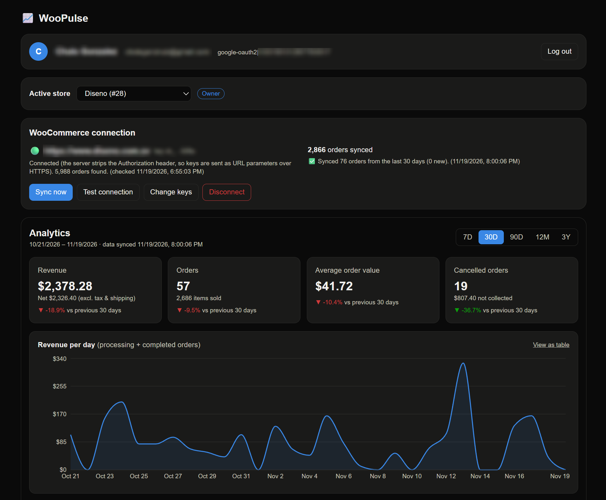
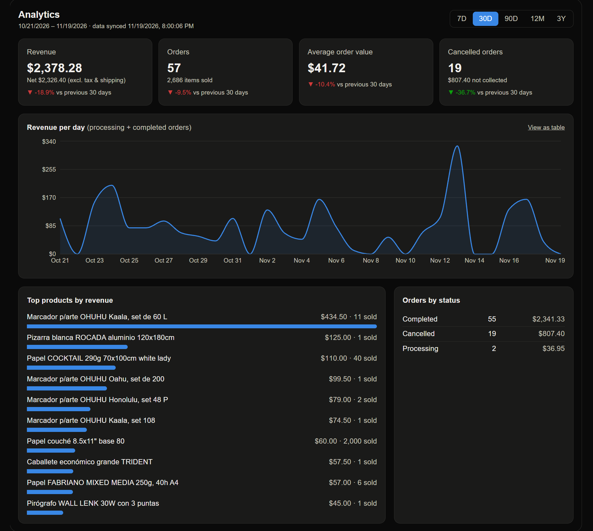
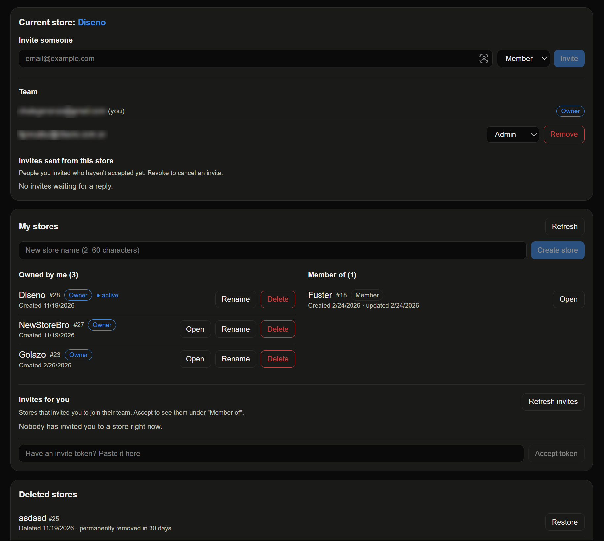

# WooPulse

WooPulse is a multi-tenant dashboard for WooCommerce stores. It connects to a shop through the WooCommerce REST API, keeps a local copy of its orders in sync, and turns them into the numbers I actually check every day: revenue, orders, average order value, cancellations and best-selling products. Each store has its own team, so the people I work with can see the data for the stores they belong to and nothing else.

I use it to keep an eye on my own stores. It is also a portfolio project, so the code is written to be read: every change is documented, and the architecture favors clear boundaries over clever shortcuts.

<p align="center">
  
</p>

<table>
  <tr>
    <td width="50%" align="center">
      
    </td>
    <td width="50%" align="center">
      
    </td>
  </tr>
  <tr>
    <td align="center"><sub>Analytics: KPIs against the previous period, revenue per day, top products and order statuses</sub></td>
    <td align="center"><sub>Stores and teams: invites, roles, owned and shared stores, restorable deletes</sub></td>
  </tr>
</table>

## Features

- **Store analytics.** Revenue, net revenue, orders, average order value, items sold and cancelled orders, each compared with the previous period of the same length. Revenue over time (daily or monthly), top products by revenue and a breakdown by order status. Ranges from 7 days to 3 years.
- **WooCommerce sync.** Connect a shop with a read-only API key. The first sync imports up to 3 years of orders, then a background job refreshes every 15 minutes. Members can also trigger a sync on demand and watch progress live.
- **Teams and roles.** Every store has an Owner, Admins and Members. Owners and Admins invite people by email, change roles and remove members. Invites expire after 7 days and can be revoked.
- **Safe deletes.** Deleting a store moves it to a trash where the owner can restore it for 30 days. A daily job removes it permanently after that.
- **Auth0 login.** Email and password or Google sign-in, handled entirely by Auth0.

## Architecture

```
Browser (React)
   │  same-origin requests, encrypted session cookie only
   ▼
Next.js 16 (Backend for Frontend)
   │  reads the Auth0 access token from the session, forwards the call
   │  Authorization: Bearer <token>
   ▼
ASP.NET Core 8 minimal API ──────► WooCommerce REST API (wc/v3, read only)
   │  validates the JWT, applies per-store rules        ▲
   │                                                    │
   ├── Hangfire workers (sync every 15 min, cleanup jobs) ┘
   ▼
PostgreSQL 16 (app database + Hangfire database)
```

The browser never sees an access token. It only talks to the Next.js server, which holds the session and calls the .NET API on the user's behalf. All business rules live in the API.

## Design decisions worth a look

These are the parts of the codebase I would point a reviewer to first.

**Backend for Frontend for token safety.** Tokens stay on the server, so a cross-site scripting bug in the UI cannot leak them. Every Next.js route goes through one small proxy helper (`lib/api-proxy.ts`) that returns consistent 401 and 502 responses and encodes route parameters so a crafted URL cannot reach a different API endpoint.

**Authorization in one place.** Auth0 answers "who are you". The API answers "what may you do in this store", based on the user's membership and role. A user who is not a member of a store gets a 404, never a 403, so the API does not even confirm that the store exists.

**Encrypted credentials.** WooCommerce keys are encrypted at rest with ASP.NET Core Data Protection, using a dedicated purpose string. The API never returns them, only a hint like `ck_…a1b2`. The HTTP client used for WooCommerce has request logging turned off, because some servers force the keys into the query string and those URLs would otherwise end up in the logs.

**A sync engine that tolerates real servers.** The WooCommerce client falls back from header authentication to query string authentication when the hosting strips the `Authorization` header (it happened on my own shop). Orders are fetched in pages of 100 and upserted per page in a single transaction. Each store has a sync lock taken with a conditional `UPDATE ... WHERE locked_until < now`, so the scheduled job and a manual "Sync now" can never run at the same time, and a crash only holds the lock until it expires.

**Race-safe state changes.** Accepting or revoking an invite uses the same conditional update pattern. Two simultaneous clicks cannot both succeed, and the loser gets a clean 409 instead of a server error.

**Analytics computed by the database.** Every number on the dashboard comes from a `GROUP BY` query backed by a `(StoreId, CreatedLocalDate)` index. Days are counted in the shop's own time zone, gaps in the chart are filled with zeros, and the whole dashboard is served from a single request.

**Privacy by design.** The sync stores amounts, statuses, dates and products. It does not store customer names, emails or addresses, because analytics never needs them.

**Soft delete with global query filters.** Deleted stores disappear from every query automatically through EF Core query filters. Restoring and purging opt out explicitly with `IgnoreQueryFilters()`, which keeps the exceptions easy to find.

**A small `Program.cs`.** Startup reads like a table of contents. Configuration lives in `Setup/` as extension methods, endpoints are grouped per feature in `Endpoints/`, and the endpoints stay thin: they translate HTTP into service calls, and the services hold the rules.

**Encapsulated UI blocks.** The page only holds the state its blocks share (who is logged in, the stores, the active store). Each block fetches its own data and handles its own errors. Shared primitives live in `components/ui.tsx` and the chart colors are CSS tokens with dedicated dark mode values.

## Tech stack

| Layer | Technology |
|---|---|
| Frontend | Next.js 16 (App Router), React 19, TypeScript, Tailwind CSS 4, Recharts |
| Authentication | Auth0 (`@auth0/nextjs-auth0` on the web side, JWT bearer validation in the API) |
| API | ASP.NET Core 8 minimal APIs, C# 12 |
| Data | PostgreSQL 16, Entity Framework Core 8 (Npgsql) |
| Background jobs | Hangfire with PostgreSQL storage |
| Local infrastructure | Docker Compose |

## Project structure

```
apps/
  api/
    docker-compose.yml          PostgreSQL for local development
    WooPulse.Api/
      Program.cs                startup: services, middleware, jobs, endpoints
      Setup/                    configuration as extension methods
      Endpoints/                HTTP endpoints, one file per feature
      Services/                 business rules (stores, members, sync, analytics)
      Integrations/WooCommerce/ REST client and WooCommerce JSON models
      Data/                     EF Core entities and DbContext
      Dtos/                     request and response shapes
      Migrations/               database schema history
  web/
    woopulse/
      app/                      page, layout and the BFF routes under app/api
      components/               one component per dashboard block
      lib/                      API helpers, Auth0 client, shared types
DEVLOG.md                       every change, with the reasoning behind it
```

## Running it locally

**Prerequisites:** .NET 8 SDK, Node.js 20 or newer, pnpm, Docker, the EF Core CLI (`dotnet tool install --global dotnet-ef`) and an Auth0 tenant.

**1. Database**

```bash
cd apps/api
docker compose up -d
```

**2. Auth0**

- A **Regular Web Application** for the Next.js app, with `http://localhost:3000/auth/callback` as an allowed callback URL and `http://localhost:3000` as an allowed logout URL.
- An **API** with the identifier `https://api.woopulse.local`.
- A post-login **Action** that adds the user's email to the access token under the claim `https://woopulse.local/email`. Invites are matched by that email.

**3. API**

```bash
cd apps/api/WooPulse.Api
dotnet user-secrets set "ConnectionStrings:AppDb" "Host=localhost;Port=5432;Database=woopulse;Username=woopulse;Password=woopulse"
dotnet user-secrets set "ConnectionStrings:HangfireDb" "Host=localhost;Port=5432;Database=hangfire;Username=woopulse;Password=woopulse"
dotnet user-secrets set "Auth0:Domain" "<your-tenant>.us.auth0.com"
dotnet ef database update
dotnet run --launch-profile http
```

The API listens on `http://localhost:5113`. In development, Swagger is at `/swagger` and the Hangfire dashboard at `/hangfire`.

**4. Web app**

Create `apps/web/woopulse/.env.local`:

```
AUTH0_SECRET=<a long random string>
AUTH0_DOMAIN=<your-tenant>.us.auth0.com
AUTH0_CLIENT_ID=<web application client id>
AUTH0_CLIENT_SECRET=<web application client secret>
AUTH0_AUDIENCE=https://api.woopulse.local
AUTH0_SCOPE=openid profile email
APP_BASE_URL=http://localhost:3000
API_BASE_URL=http://localhost:5113
```

Then:

```bash
cd apps/web/woopulse
pnpm install
pnpm dev
```

Open `http://localhost:3000`, log in, create a store and connect it with a WooCommerce key (WooCommerce, Settings, Advanced, REST API, permission set to Read).

## Development log

[`DEVLOG.md`](DEVLOG.md) records every addition and fix: what changed, why, how it works and how it was verified, including the bugs found along the way and how they were tracked down. It is written so a junior developer could pick up the project from it.

## Status

The MVP is complete: teams, WooCommerce sync, analytics and the dashboard. Next on the list are dependency upgrades, automated tests for the permission rules and email delivery for invites.

## Built with Claude

WooPulse was co-authored by me and Claude (Anthropic) working as pair programmers. I set the product direction, the architecture and the rules, reviewed every change and tested it against my own stores. The commits carry both of our names.

## License

Copyright (c) 2026 Fernando González Ruiz. All rights reserved.

This repository is public so the code can be reviewed as part of my portfolio. No license is granted to use, copy, modify or distribute it.
